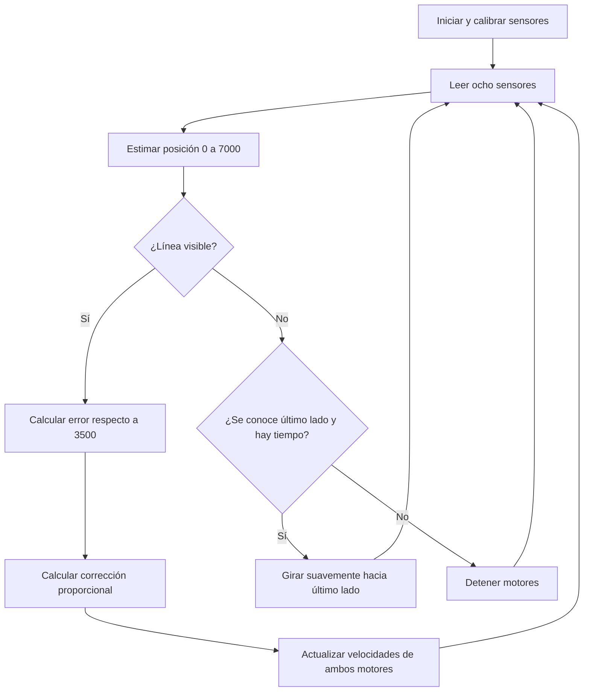

# KAIZEN DŌJŌ 2026 — Seguidor de línea autónomo con Arduino Nano y QTR de 8 sensores

**Nivel:** básico–intermedio · **Objetivo:** construir, comprender y modificar el algoritmo de un robot diferencial que sigue una línea negra sobre fondo blanco.

> **Idea clave:** el robot no memoriza una trayectoria. Percibe dónde está la línea, calcula cuánto debe corregir y ajusta la velocidad de cada rueda. Repite el proceso mientras avanza.

Este tutorial está diseñado para aprender por etapas, no para empezar copiando un PID completo. Se basa en la librería oficial de Pololu y en experiencias publicadas de seguidores de línea con Arduino Nano.

## 1. Componentes y alcance

| Elemento | Cantidad | Función |
|---|---:|---|
| Arduino Nano clásico (ATmega328P) | 1 | Ejecutar el algoritmo |
| Arreglo Pololu **QTR-8A** (8 sensores analógicos) | 1 | Percibir reflectancia y ubicación de la línea |
| Motores DC con reductora y ruedas | 2 | Propulsión diferencial |
| Driver **TB6612FNG** | 1 | Alimentar, invertir y modular ambos motores |
| Chasis y apoyo delantero/trasero | 1 | Montaje estable |
| Batería adecuada para los motores y fuente regulada/USB para Nano | 1 de cada tipo | Alimentación segura |
| Cables e interruptor | Según necesidad | Conexiones |

**El ejemplo usa QTR-8A analógico.** Si tu arreglo es **QTR-8RC**, ve a la sección 12. Ambos tienen ocho sensores, pero emplean formas distintas de lectura.

**Precauciones eléctricas:** no alimentes los motores desde pines del Nano; conecta todas las tierras (GND) entre sí. Comprueba que la corriente de arranque/bloqueo de los motores sea compatible con tu driver. Para el primer ensayo, usa USB para el Nano y una fuente de motor apropiada para `VM`. Si alimentas el Nano sin USB, usa una fuente regulada y el pin de entrada que corresponda.

## 2. ¿Qué observan los ocho sensores?

Cada sensor mide cuánta luz infrarroja refleja el suelo. Un fondo blanco refleja más; una línea negra, menos. Tras **calibrar**, la librería convierte las ocho lecturas en valores aproximadamente entre `0` (claro) y `1000` (oscuro).

**Orientación física exigida por este ejemplo:** mirando hacia adelante desde el robot, `S0` debe ser el sensor más a la izquierda y `S7` el más a la derecha.

```text
                   DIRECCIÓN DE AVANCE
                           ↑
        IZQUIERDA                   DERECHA
        [S0][S1][S2][S3][S4][S5][S6][S7]
                       ││
                    LÍNEA NEGRA
                 ┌──────────┐
                 │  NANO    │
          rueda I│          │rueda D
                 └──────────┘
```

**Ejemplo conceptual (valores calibrados):**

| Sensor | S0 | S1 | S2 | S3 | S4 | S5 | S6 | S7 |
|---|---:|---:|---:|---:|---:|---:|---:|---:|
| Línea centrada | 0 | 0 | 0 | 850 | 850 | 0 | 0 | 0 |
| Línea a la izquierda | 0 | 900 | 700 | 0 | 0 | 0 | 0 | 0 |
| Línea a la derecha | 0 | 0 | 0 | 0 | 0 | 700 | 900 | 0 |

Las lecturas reales variarán con la luz, la altura, el ancho de cinta y la calibración.

## 3. Un solo número resume las ocho lecturas

En lugar de decidir con 256 combinaciones binarias posibles (`2^8`), usamos la estimación de posición:

```cpp
uint16_t posicion = qtr.readLineBlack(valores);
```

La librería devuelve una posición de `0` a `7000`:

| Posición | Interpretación |
|---:|---|
| `0` | Línea hacia el extremo izquierdo |
| `1500` | Línea a la izquierda |
| `3500` | Línea centrada |
| `5500` | Línea a la derecha |
| `7000` | Línea hacia el extremo derecho |

Conceptualmente, la posición se calcula como un **promedio ponderado** de los valores de los sensores:

\[
\text{posición}\approx\frac{\sum_{i=0}^{7} 1000\,i\,s_i}{\sum_{i=0}^{7}s_i}
\]

La implementación real de Pololu incorpora umbrales y memoria de la última posición para manejar lecturas muy débiles.

**Importante:** si la línea desaparece, `readLineBlack()` puede devolver el último extremo conocido. Por eso *posición extrema* no equivale necesariamente a *línea visible*. El código debe comprobar también las lecturas individuales.

## 4. Arquitectura de software: percibir → decidir → actuar



Se separan conceptualmente cinco responsabilidades:

1. **Percepción:** medir reflectancia.
2. **Estimación:** obtener la posición de la línea.
3. **Decisión:** seguir, buscar o detenerse.
4. **Control:** decidir las velocidades de las ruedas.
5. **Actuación:** aplicar PWM y sentido de giro mediante el driver.

Esto constituye un **lazo cerrado** porque cada acción se corrige con una nueva lectura del entorno.

## 5. Algoritmo A: decisiones sencillas sin fórmulas

Para empezar, se puede elegir entre tres movimientos:

```text
SI la línea está centrada:
    avanzar recto
SI la línea está a la izquierda:
    girar a la izquierda
SI la línea está a la derecha:
    girar a la derecha
```

Ejemplo con velocidades PWM de 0 a 255:

| Situación | Motor izquierdo | Motor derecho | Resultado |
|---|---:|---:|---|
| Centrado | 130 | 130 | Recto |
| Línea a la izquierda | 70 | 150 | Gira a la izquierda |
| Línea a la derecha | 150 | 70 | Gira a la derecha |

Un primer ejercicio de programación, aún sin librerías de control, sería:

```cpp
if (posicion < 3000) {
  mover(70, 150);
} else if (posicion > 4000) {
  mover(150, 70);
} else {
  mover(130, 130);
}
```

Este algoritmo permite aprender `if/else`, comparación, funciones y control de motores, pero tiende a zigzaguear porque usa pocas velocidades fijas.

## 6. Algoritmo B: controlar cuánto corregir (control proporcional P)

Definimos el **error lateral** como:

\[
e=\text{posición}-3500
\]

- `e = 0`: línea centrada.
- `e < 0`: línea a la izquierda.
- `e > 0`: línea a la derecha.

En vez de girar siempre lo mismo, calculamos una corrección proporcional:

\[
c=K_p\,e
\]

Las velocidades objetivo son:

\[
V_{I}=V_{base}+c
\qquad
V_{D}=V_{base}-c
\]

Se limitan las velocidades permitidas a `0...255` mientras el robot sigue la línea; los giros de búsqueda pueden incluir velocidad negativa para hacer pivote.

**Ejemplo:** `Vbase = 125`, `Kp = 0.045`.

| Posición | Error | Corrección aprox. | Izquierda | Derecha | Decisión |
|---:|---:|---:|---:|---:|---|
| 3500 | 0 | 0 | 125 | 125 | Recto |
| 1500 | −2000 | −90 | 35 | 215 | Corregir izquierda |
| 5500 | +2000 | +90 | 215 | 35 | Corregir derecha |

Código esencial:

```cpp
int error = (int)posicion - 3500;
int correccion = (int)(0.045f * error);
int izq = constrain(125 + correccion, 0, 255);
int der = constrain(125 - correccion, 0, 255);
mover(izq, der);
```

**Preguntas para el estudiante:** ¿qué sucede si duplicamos `Kp`? ¿Qué pasa si aumentamos la velocidad base sin mejorar la capacidad de giro? ¿Por qué se invierte la relación de velocidades al cambiar de lado la línea?

## 7. Algoritmo C: recuperar la línea cuando desaparece

No basta con ejecutar siempre el control proporcional; una curva cerrada puede dejar los ocho sensores sobre fondo blanco. Añadimos una memoria muy sencilla: `ultimoLado`.

```text
SI la línea es visible:
    actualizar velocidad de los motores
    guardar el último lado observado
SI NO es visible:
    SI antes estaba a la izquierda:
        girar sobre sí mismo hacia la izquierda
    SI antes estaba a la derecha:
        girar sobre sí mismo hacia la derecha
    SI no hay dirección conocida o pasó mucho tiempo:
        detenerse
```

La estrategia de búsqueda que se incluye en el código se interrumpe tras 1,5 segundos sin recuperar la línea. Ese valor es una **decisión didáctica de seguridad**, no una propiedad de los sensores. Para reiniciar la búsqueda después de detenerse, se puede reiniciar el programa y volver a calibrar.

En el programa, consideramos que hay línea cuando **alguno** de los valores calibrados supera `200`. Es un umbral inicial que debe revisarse experimentalmente en cada pista. Las intersecciones, líneas dobles y cruces requieren una política aparte.

## 8. Conexiones propuestas

### Arreglo QTR-8A → Arduino Nano

| Salida del QTR | Nano |
|---|---|
| Sensor físico izquierdo S0 (salida 1) | A0 |
| S1 (salida 2) | A1 |
| S2 (salida 3) | A2 |
| S3 (salida 4) | A3 |
| S4 (salida 5) | A4 |
| S5 (salida 6) | A5 |
| S6 (salida 7) | A6 |
| S7 (salida 8) | A7 |
| VCC | 5 V regulados |
| GND | GND común |

`LEDON`/`CTRL`, cuando exista, puede dejarse sin conectar en las versiones que encienden por defecto los emisores. Verifica la serigrafía y la hoja de datos específica de tu arreglo. En el Nano clásico, A6 y A7 sirven como entradas analógicas, no como salidas digitales.

### TB6612FNG → Arduino Nano

| TB6612FNG | Nano / conexión |
|---|---|
| PWMA | D3 (PWM) |
| AIN1 | D7 |
| AIN2 | D8 |
| PWMB | D5 (PWM) |
| BIN1 | D9 |
| BIN2 | D10 |
| STBY | D4 |
| AO1/AO2 | Motor izquierdo |
| BO1/BO2 | Motor derecho |
| VCC | 5 V regulados |
| VM | Fuente apropiada para motores |
| GND | Tierra común |

Si el giro real queda invertido, revisar el cableado de cada motor, sus terminales o la convención de sentido. `STBY` debe estar en nivel alto para habilitar el driver.

## 9. Programa funcional de referencia

Archivo para Arduino IDE: **[`seguidor_nano_qtr8.ino`](seguidor_nano_qtr8/seguidor_nano_qtr8.ino)**.

El programa está organizado deliberadamente en pocas funciones:

- `controlarMotor(...)`: velocidad y dirección de un motor.
- `mover(izquierda, derecha)`: velocidad de ambos motores.
- `setup()`: configurar y calibrar.
- `loop()`: leer, estimar, seguir o recuperar la línea.

En `loop()` la secuencia esencial es:

```cpp
uint16_t posicion = qtr.readLineBlack(valores);

bool lineaVisible = false;
for (uint8_t i = 0; i < 8; i++) {
  if (valores[i] > 200) lineaVisible = true;
}

if (lineaVisible) {
  int error = (int)posicion - 3500;
  int correccion = (int)(KP * error);
  mover(constrain(VELOCIDAD_BASE + correccion, 0, 255),
        constrain(VELOCIDAD_BASE - correccion, 0, 255));
} else {
  // Se utiliza el último lado conocido para buscar la línea.
  // Consultar el archivo .ino para el algoritmo completo.
}
```

**No copies solo el fragmento anterior:** el archivo `.ino` incluye pines, inicialización, calibración, control de sentido de motor, memoria de la última dirección y detención de seguridad.

## 10. Estrategia de programación para aprender de forma autónoma

| Kata | Objetivo de aprendizaje | Actividad práctica | Evidencia mínima |
|---|---|---|---|
| 1. Percibir | Leer arreglos y valores analógicos | Cargar [`diagnostico_qtr8.ino`](diagnostico_qtr8/diagnostico_qtr8.ino); observar 8 valores y posición | Registrar un caso izquierda/centro/derecha |
| 2. Actuar | Relacionar PWM con movimiento | Con ruedas levantadas, probar `mover(100,100)`, `mover(60,150)` y `mover(150,60)` | Identificar sentidos de giro |
| 3. Decidir | Usar `if/else` | Aplicar el algoritmo A con tres decisiones | Seguir una recta y curva amplia |
| 4. Controlar | Comprender error y ganancia | Sustituir decisiones fijas por control P | Reducir zigzagueo ajustando `Kp` |
| 5. Recuperar | Integrar memoria y condiciones | Implementar búsqueda hacia el último lado | Recuperar la línea en una curva |
| 6. Mejorar | Medir e iterar | Cambiar un parámetro y repetir la prueba | Comparar fallos antes/después |

**Orden de prueba recomendado:** primero sensores sin mover motores, después motores con ruedas levantadas, después seguimiento a velocidad baja. No se deben ajustar simultáneamente sensor, `Kp` y velocidad, porque sería difícil saber qué cambio mejoró el comportamiento.

## 11. Depuración y mejoras

| Síntoma | Posible causa | Primera acción |
|---|---|---|
| Siempre indica centro | Calibración insuficiente | Desplazar todos los sensores por negro y blanco |
| Gira hacia el lado incorrecto | Orden invertido S0–S7 o motores invertidos | Comprobar orientación y signos de giro |
| Zigzaguea mucho | Corrección P fuerte o velocidad elevada | Reducir `Kp` o velocidad base |
| Pierde línea en curvas | Corrección insuficiente, velocidad elevada | Bajar velocidad base y ajustar `Kp` |
| Se detiene después de una curva | No recuperó línea en tiempo límite | Mejorar el algoritmo de búsqueda |
| Lecturas inestables | Altura, luz, alimentación o cableado | Ajustar altura, calibración y alimentación |

Como mejora opcional, se puede utilizar **control PD**:

\[
c = K_p e + K_d(e-e_{anterior})
\]

El término proporcional reacciona al error actual; el derivativo reacciona al **cambio** de error y puede reducir oscilaciones. Si se usa un periodo de muestreo variable, la derivada debe normalizarse por el tiempo transcurrido. Es recomendable dominar primero el control P.

## 12. ¿Y si el arreglo es QTR-8RC?

El QTR-8RC entrega pulsos cuya duración se mide con pines de E/S digital, no ocho tensiones analógicas. **No conectes QTR-8RC a A6 y A7 para lectura digital en el Nano clásico.** Con el mismo cableado del driver del apartado 8, una asignación alternativa para los sensores RC es:

```cpp
qtr.setTypeRC();
qtr.setSensorPins((const uint8_t[]){2, 6, 11, 12, A0, A1, A2, A3}, 8);
qtr.setTimeout(2500);
```

Los ocho cables de señal deben conectarse físicamente en ese orden. El resto de la lógica (`calibrate()`, `readLineBlack()`, error y control diferencial) permanece conceptualmente igual.

## 13. Reto Kaizen

**Meta:** completar tres vueltas consecutivas sin perder la línea, y documentar al menos una mejora demostrable.

Registrar, como mínimo:

1. Valor de `Kp` y velocidad base.
2. Número de pérdidas de línea en tres vueltas.
3. Una modificación realizada y su justificación.
4. Comparación antes/después con la misma pista.

**Reflexión:** ¿qué parte del comportamiento es percepción, qué parte es decisión y qué parte es control? ¿Cuál de esas partes limitaba más el desempeño del robot?

## Referencias consultadas

- [Pololu: repositorio oficial `qtr-sensors-arduino`](https://github.com/pololu/qtr-sensors-arduino)
- [Pololu: ejemplos y API de `QTRSensors`](https://pololu.github.io/qtr-sensors-arduino/)
- [Pololu: guía técnica QTR-8A / QTR-8RC](https://www.pololu.com/docs/0J12/all)
- [Arduino Nano: especificaciones oficiales](https://store.arduino.cc/products/arduino-nano)
- [Arduino: pines PWM oficiales](https://support.arduino.cc/hc/en-us/articles/9350537961500-Use-PWM-output-with-Arduino)
- [Pololu: driver TB6612FNG](https://www.pololu.com/product/713/specs)
- [adamyasinghal: seguidor Nano + QTR-8A + TB6612FNG](https://github.com/adamyasinghal/line-following-robot)
- [KSRautela: seguidor Nano + sensores analógicos + PID](https://github.com/KSRautela/LineFollower_PID)
- [Sndcooper: progresión desde seguidores simples hasta PID](https://github.com/Sndcooper/PID-LineFollower)

**Nota:** los parámetros numéricos presentados son puntos de partida para experimentar. La configuración física debe comprobarse antes de mover el robot; el código no se ha validado en un montaje real.
