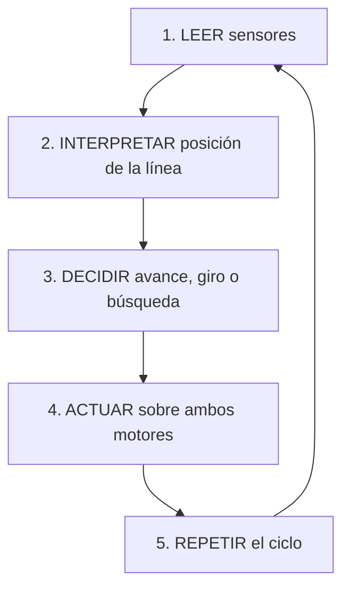

# Mini tutorial: robot seguidor de línea

**KAIZEN DŌJŌ 2026 · Robótica para principiantes**  
**Misión:** construir y programar un robot móvil autónomo capaz de seguir una línea negra sobre una superficie blanca, detectar curvas y corregir su trayectoria.

> **Idea central:** un robot seguidor de línea es un ejemplo de **control en lazo cerrado**: observa, decide, actúa y vuelve a observar.

## Objetivos de aprendizaje

Al completar el tutorial podrás:

- Integrar **sensores, actuadores y un microcontrolador**.
- Programar decisiones usando `if`, `else if` y `else`.
- Controlar velocidad y sentido de giro de motores mediante **PWM** y un driver.
- Implementar algoritmos de seguimiento y recuperación de línea.
- Mejorar el comportamiento del robot mediante **pruebas e iteraciones**.

## 1. Componentes mínimos necesarios

Usaremos un Arduino y **tres sensores infrarrojos digitales**. Es posible hacerlo con dos, pero tres permiten distinguir de forma sencilla cuándo el robot está centrado y hacia qué lado debe corregir.

| Componente | Cantidad | Función |
|---|:---:|---|
| Arduino Uno o Nano | 1 | Ejecutar el programa de control |
| Sensor infrarrojo TCRT5000 con salida digital (`DO`) | 3 | Detectar superficie negra o blanca |
| Motor DC con reductora y rueda | 2 | Propulsar el robot |
| Driver de motores TB6612FNG | 1 | Controlar velocidad y sentido de ambos motores |
| Rueda loca o apoyo deslizante | 1 | Estabilizar el chasis |
| Chasis | 1 | Sujetar los componentes |
| Portapilas y pilas apropiadas para los motores | 1 | Alimentar los motores |
| Cables, interruptor y alimentación USB de 5 V para Arduino | Según necesidad | Completar las conexiones |

**Alimentación sugerida para la primera prueba:** motores nominales de 6 V con un portapilas de cuatro pilas AA y Arduino alimentado por USB de 5 V. La tensión real dependerá del tipo de pila; verifica siempre los límites de tus motores y del driver.

> [!WARNING]
> No conectes los motores directamente a los pines del Arduino. El TB6612FNG requiere alimentación lógica en `VCC`, alimentación de motores en `VM` y **tierra común (`GND`)** con el Arduino. No conectes el positivo de la batería de motores al pin de 5 V del Arduino.

## 2. ¿Cómo funciona?

Un sensor infrarrojo ilumina el suelo y mide la luz reflejada. Una superficie blanca suele reflejar más luz que una negra. Cada módulo entrega una señal digital cuyo significado **debe verificarse**, porque algunos módulos reportan `HIGH` cuando ven negro y otros `LOW`.

### Posición de los tres sensores

Vista frontal simplificada, con el robot avanzando hacia arriba:

```text
               DIRECCIÓN DE AVANCE
                        ↑

   SUPERFICIE BLANCA      LÍNEA NEGRA       SUPERFICIE BLANCA
                             █████
       [ I ]               [ C ]               [ D ]
       sensor              sensor              sensor
      izquierdo            central             derecho
                             █████

                  CHASIS DEL ROBOT
```

- Si la línea queda bajo el **sensor izquierdo**, el robot debe corregir a la **izquierda**.
- Si queda bajo el **sensor derecho**, debe corregir a la **derecha**.
- Si el **sensor central** ve la línea, normalmente puede avanzar recto.

## 3. Arquitectura de software

Organizaremos el programa en cinco bloques lógicos:



| Bloque | Pregunta que responde | Acción |
|---|---|---|
| **Leer** | ¿Qué ve cada sensor? | Obtener tres valores digitales |
| **Interpretar** | ¿Dónde está la línea? | Reconocer un patrón de tres bits |
| **Decidir** | ¿Qué corrección hace falta? | Elegir entre avance, giro o búsqueda |
| **Actuar** | ¿Cómo se ejecuta la corrección? | Enviar dirección y PWM a los motores |
| **Repetir** | ¿Cambió la posición de la línea? | Volver a leer sin interrupción |

**Principio:** percepción → decisión → acción → nueva percepción.

## 4. Algoritmos principales

### Algoritmo A. Seguimiento mediante decisiones

Convención didáctica: **`1` significa «detecta negro»** y **`0` significa «detecta blanco»**. En el programa convertiremos la señal eléctrica a esta convención.

| Izquierdo | Central | Derecho | Acción |
|:---:|:---:|:---:|---|
| 0 | 1 | 0 | Avanzar recto |
| 1 | 1 | 0 | Girar suavemente a la izquierda |
| 1 | 0 | 0 | Girar más a la izquierda |
| 0 | 1 | 1 | Girar suavemente a la derecha |
| 0 | 0 | 1 | Girar más a la derecha |
| 0 | 0 | 0 | Buscar la línea perdida |
| 1 | 1 | 1 | Continuar recto (posible cruce) |
| 1 | 0 | 1 | Detenerse (lectura ambigua) |

> [!NOTE]
> La tabla supone una pista sencilla **sin bifurcaciones** y una separación de sensores adecuada al ancho de la línea. Cruces, marcas y líneas muy anchas pueden necesitar otra estrategia.

Pseudocódigo del seguimiento:

```text
LEER sensor izquierdo, central y derecho

SI los extremos ven negro y el centro ve blanco:
    DETENER
SINO SI el sensor izquierdo ve negro y el derecho no:
    GIRAR a la izquierda (suave o fuerte según el central)
SINO SI el sensor derecho ve negro y el izquierdo no:
    GIRAR a la derecha (suave o fuerte según el central)
SINO SI el sensor central ve negro:
    AVANZAR
SINO:
    BUSCAR la línea
```

### Algoritmo B. Control diferencial de motores

El robot gira porque sus ruedas tienen velocidades diferentes. Las cifras siguientes son **valores iniciales de PWM de 0 a 255**, no velocidades físicas medidas.

| Movimiento | Motor izquierdo | Motor derecho |
|---|---:|---:|
| Recto | 150 | 150 |
| Izquierda | 80 | 160 |
| Derecha | 160 | 80 |

- Para girar a la **izquierda**, el motor derecho debe avanzar más rápido.
- Para girar a la **derecha**, el izquierdo debe avanzar más rápido.
- Para girar sobre su eje durante una búsqueda, un motor puede girar hacia atrás y el otro hacia adelante.

### Algoritmo C. Recuperación de línea perdida

Si **ningún sensor detecta negro**, el robot necesita decidir dónde buscar. La versión básica recuerda el último lado hacia el que corrigió:

```text
SI se perdió la línea:
    SI el último giro fue izquierda:
        buscar girando a la izquierda
    SINO SI el último giro fue derecha:
        buscar girando a la derecha
    SINO:
        detenerse
```

Esta estrategia incorpora una forma sencilla de **memoria del estado anterior**. Para una versión más segura puede añadirse un límite de tiempo de búsqueda y una parada si no se recupera la línea.

## 5. Conexiones electrónicas básicas

### Sensores

| Elemento | Arduino |
|---|---|
| Sensor izquierdo, salida `DO` | `D2` |
| Sensor central, salida `DO` | `D3` |
| Sensor derecho, salida `DO` | `D4` |
| Cada sensor, `VCC` | `5V`, si el módulo es compatible |
| Cada sensor, `GND` | `GND` |

### Driver TB6612FNG

| Pin del driver | Conectar a | Función |
|---|---|---|
| `PWMA` | Arduino `D5` | PWM del motor izquierdo |
| `PWMB` | Arduino `D6` | PWM del motor derecho |
| `AIN1` / `AIN2` | Arduino `D7` / `D8` | Sentido del motor izquierdo |
| `BIN1` / `BIN2` | Arduino `D9` / `D10` | Sentido del motor derecho |
| `STBY` | Arduino `D11` | Habilitación del driver |
| `AO1` / `AO2` | Motor izquierdo | Salida hacia el motor |
| `BO1` / `BO2` | Motor derecho | Salida hacia el motor |
| `VCC` | Arduino `5V` | Alimentación lógica |
| `VM` | Positivo de batería de motores | Alimentación de potencia |
| `GND` | GND común de Arduino y batería | Referencia eléctrica compartida |

> [!IMPORTANT]
> **Antes de colocar el robot sobre la pista:** comprueba con las ruedas levantadas que el comando `mover(140, 140)` impulsa **las dos ruedas hacia adelante**. Si una gira al revés, intercambia sus dos cables o invierte su lógica de dirección en el código.

## 6. Programa básico en Arduino

Este ejemplo integra seguimiento, control diferencial y recuperación.

```cpp
const int SI = 2, SC = 3, SD = 4;
const int PWMI = 5, PWMD = 6;
const int I1 = 7, I2 = 8;
const int D1 = 9, D2 = 10;
const int STBY = 11;

// Cambiar a LOW si tu sensor entrega LOW sobre negro.
const int NEGRO = HIGH;

int ultimoGiro = 0;  // -1: izquierda, 1: derecha, 0: desconocido

void motor(int pwm, int p1, int p2, int velocidad) {
  velocidad = constrain(velocidad, -255, 255);

  if (velocidad == 0) {
    digitalWrite(p1, LOW);
    digitalWrite(p2, LOW);
  } else {
    digitalWrite(p1, velocidad > 0 ? HIGH : LOW);
    digitalWrite(p2, velocidad > 0 ? LOW : HIGH);
  }

  analogWrite(pwm, abs(velocidad));
}

void mover(int izq, int der) {
  motor(PWMI, I1, I2, izq);
  motor(PWMD, D1, D2, der);
}

void setup() {
  pinMode(SI, INPUT);
  pinMode(SC, INPUT);
  pinMode(SD, INPUT);

  const int salidas[] = {PWMI, PWMD, I1, I2, D1, D2, STBY};
  for (int p : salidas) {
    pinMode(p, OUTPUT);
  }

  digitalWrite(STBY, HIGH);
  mover(0, 0);
}

void loop() {
  // Estas variables son verdaderas cuando el sensor ve NEGRO.
  bool I = digitalRead(SI) == NEGRO;
  bool C = digitalRead(SC) == NEGRO;
  bool D = digitalRead(SD) == NEGRO;

  if (I && D && !C) {
    mover(0, 0);              // Lectura ambigua
  }
  else if (I && !D) {
    ultimoGiro = -1;
    if (C) mover(90, 160);    // Izquierda suave
    else   mover(55, 175);   // Izquierda fuerte
  }
  else if (D && !I) {
    ultimoGiro = 1;
    if (C) mover(160, 90);    // Derecha suave
    else   mover(175, 55);   // Derecha fuerte
  }
  else if (C) {
    mover(140, 140);         // Línea centrada o todos en negro
  }
  else {
    // Recuperar la línea según la última dirección conocida.
    if (ultimoGiro == -1)      mover(-85, 85);
    else if (ultimoGiro == 1)  mover(85, -85);
    else                       mover(0, 0);
  }

  delay(12);
}
```

**Cómo probarlo:**

1. Abre el IDE de Arduino, crea un sketch y pega el programa.
2. Selecciona la placa y el puerto correctos.
3. Verifica la polaridad de los sensores (`NEGRO = HIGH` o `LOW`).
4. Sube el programa y prueba los motores **con las ruedas levantadas**.
5. Coloca el robot sobre la pista y comienza con una velocidad moderada.
6. Ajusta los valores PWM si gira demasiado o no logra tomar las curvas.

## 7. Pruebas e iteración

### Prueba 1. Calibrar sensores

Sitúa los sensores **aproximadamente a 5 mm de la superficie**, siempre dentro de la distancia recomendada por el módulo. Deslízalos entre blanco y negro y ajusta, si corresponde, el potenciómetro de cada módulo para lograr lecturas consistentes.

### Prueba 2. Verificar motores

Comprueba que ambos motores avanzan cuando reciben velocidad positiva y que reducir la velocidad del izquierdo produce un giro a la izquierda.

### Prueba 3. Seguir una pista

Construye una pista con **cinta negra de unos 20 mm de ancho** sobre fondo blanco; ajusta el ancho a la separación real de tus sensores. Comienza con una recta, continúa con curvas amplias y finalmente prueba curvas cerradas.

### Prueba 4. Mejorar mediante Kaizen

Modifica **una sola variable a la vez**: velocidad base, diferencia de velocidad entre ruedas o distancia/separación de sensores. Repite cada prueba varias veces y registra cuántas veces se pierde la línea.

| Iteración | Cambio realizado | Vueltas completadas | Veces que perdió la línea | Observaciones |
|---|---|---:|---:|---|
| 1 | Configuración inicial |  |  |  |
| 2 |  |  |  |  |
| 3 |  |  |  |  |

## 8. Siguiente nivel: control proporcional (P)

Una vez que el robot sigue la línea con decisiones discretas, puede hacerse una corrección más progresiva mediante un **controlador proporcional**.

Si `I`, `C` y `D` son variables **0 o 1** que indican detección de negro, se puede estimar un error:

$$
e = \frac{-1(I) + 0(C) + 1(D)}{I + C + D}
$$

Este error se define **solo cuando al menos un sensor ve negro** (`I+C+D>0`). Por ejemplo:

- Línea a la izquierda: `I=1, C=0, D=0` → `e=-1`.
- Línea al centro: `I=0, C=1, D=0` → `e=0`.
- Línea a la derecha: `I=0, C=0, D=1` → `e=+1`.

Con una velocidad base `Vbase` y una ganancia proporcional `Kp`:

$$
V_I = V_{base} + K_p e
$$

$$
V_D = V_{base} - K_p e
$$

Ambos comandos se limitan al rango permitido para PWM. Con `e>0` el motor izquierdo acelera respecto al derecho y el robot corrige hacia la **derecha**; con `e<0` corrige hacia la **izquierda**.

**Limitaciones:** con solo tres sensores digitales, el error tiene pocos niveles y puede ser ambiguo en cruces. Si no se detecta negro, hay que utilizar el algoritmo de recuperación. Para lograr mayor precisión se puede migrar a una barra de sensores analógicos y después estudiar control **PD o PID**.

## 9. Reto final del Dōjō

**Construye un robot capaz de completar tres vueltas consecutivas sin perder la línea.**

### Lista de verificación

- [ ] Detecta correctamente blanco y negro.
- [ ] Avanza en línea recta.
- [ ] Corrige curvas en ambos sentidos.
- [ ] Recupera la línea cuando la pierde.
- [ ] Completa tres vueltas consecutivas.
- [ ] Documenta al menos una mejora con evidencias.

### Evidencia recomendada

Entrega un video corto del robot, una fotografía de las conexiones, el código fuente y una tabla de pruebas que muestre al menos una iteración de mejora.

---

> **Aprendizaje esencial:** el objetivo no es solamente que el robot siga una línea, sino comprender cómo se integran la **percepción, toma de decisiones, control y mejora continua** para construir un sistema mecatrónico autónomo.
>
> **Kaizen Dōjō 2026:** *Confianza para atreverse. Desafío para crecer.*
